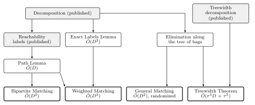
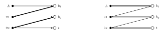

# Exact Maximum Matching in Planar Networks

> This folder continues the repository [ExactPlanarBipartiteMatching](https://github.com/ssenge/ExactPlanarBipartiteMatching), which is no longer updated; new results are added here. Its history stays there.

Distributed algorithms that compute an exact maximum matching of a planar network in a number of rounds that depends on the diameter of the network, and only polylogarithmically on its size.

**Paper:** [`paper/main.pdf`](paper/main.pdf), with its source in [`paper/`](paper/).

**Status: every result here is a claim.** The proofs are written, tested by simulation and partly formalized in Lean. See [How far to trust this](#how-far-to-trust-this).

## The problem

Each vertex of a network is a small computer that knows only its own neighbours. In one round, every pair of neighbours can exchange a message of O(log n) bits. This is the CONGEST model. At the end, every vertex must know its partner in a *maximum matching*: a largest possible set of edges in which no two edges share a vertex.

The question is how many rounds this takes. Two numbers matter:

- **n**, the number of vertices;
- **D**, the hop diameter, the largest number of hops between two vertices.

Õ hides factors polylogarithmic in n. Information must cross the network, so Ω(D) rounds are needed. On general networks the previous exact algorithms depend on the size of the matching, which can be close to n. Planar networks allow more: they have small separators, and D can be far below n.

## Main results

| Problem | Rounds here | Best previous bound |
|---|---|---|
| **Maximum matching, bipartite planar** | **Õ(D²)** | Õ(D³), implied by the classical separator method with one exact shortest-path run per insertion; Õ(D⁷), implied by the treewidth bound of [arXiv:2205.14897](https://arxiv.org/abs/2205.14897) |
| Maximum weight matching, bipartite planar | Õ(D³) | Õ(D³), implied by the same method. New here is the complete proof, since the published one is deferred to a full version |
| Maximum weight matching, bipartite planar, edge weights in {0,…,W} | Õ(D² + W·D), so Õ(D²) for W = Õ(D) | Õ(min(W·D², D³)), implied by the same method and by [arXiv:cs/0011015](https://arxiv.org/abs/cs/0011015). The gain is largest at W = D, a factor D, and vanishes for polylogarithmic W and for W ≥ D² |
| Maximum weight matching, bipartite planar, weights on the vertices, of any polynomial size | Õ(D²) | Õ(D³), implied by the same method |
| Minimum vertex cover and maximum independent set, bipartite planar | Õ(D²) | Õ(D³), from the first row with König's theorem |
| **Maximum matching, general planar**, zero error given the decomposition, with the Gallai-Edmonds sets | **Õ(D²)**, randomized | Õ(s\*), where s\* is the size of a maximum matching, [arXiv:2311.04140](https://arxiv.org/abs/2311.04140) |
| Maximum matching, treewidth τ, not necessarily planar or bipartite | Õ(τ³D + τ⁵), randomized | Õ(τ⁴D + τ⁷), bipartite only, [arXiv:2205.14897](https://arxiv.org/abs/2205.14897) |

These rows use only published decompositions and labels, plus the proofs in this repository. Previous bounds are results of other authors or direct consequences of them, to our knowledge. "Implied" means that the bound is not stated there: Õ(D⁷) follows from a treewidth bound, since a planar network has treewidth O(D), and Õ(D³) from the classical method. A perfect matching alone already takes Õ(D²) rounds through known tools, so the new point is the maximum matching, which also handles free vertices.

Two bounds improve under the **Label Hypothesis**, an assumption stated in the companion repository [ExactShortestPathsAndFlowsOnPlanarGraphs](/exact-shortest-paths-and-flows-on-planar-graphs). If the hypothesis fails, only these two rows fall away, and the bounds above still stand.

| Problem | Rounds, given the Label Hypothesis | Without it |
|---|---|---|
| Maximum weight matching, bipartite planar | Õ(D²) | Õ(D³) |
| Perfect matching of a bipartite planar network, or the report that none exists; prescribed degrees | Õ(D) | Õ(D²) |

Maximum matching does not follow from the Õ(D) row, since free vertices would need a super source, which is not planar.

## Before and after

| Category | Problem | Before | After | Scope | Status |
|---|---|---|---|---|---|
| Distributed algorithms, CONGEST | Maximum matching on bipartite planar networks | Õ(D³) from the separator scheme with one exact shortest-path computation per inserted vertex; Õ(D⁷) implied by the treewidth bound of [arXiv:2205.14897](https://arxiv.org/abs/2205.14897) | Õ(D²) | Planar bipartite networks; deterministic once the decomposition is given | Claim, with simulation; combinatorial core in Lean; paper in the folder |
| Distributed algorithms, CONGEST | Maximum matching on general planar networks, with the Gallai-Edmonds sets | Õ(s*) for a maximum matching of size s* [arXiv:2311.04140](https://arxiv.org/abs/2311.04140) | Õ(D²), randomized, with no error once the decomposition is given | Planar networks | Claim, with simulation; the matrix steps in Lean |
| Distributed algorithms, CONGEST | Maximum matching on networks of treewidth τ | Õ(τ⁴D + τ⁷), bipartite only [arXiv:2205.14897](https://arxiv.org/abs/2205.14897) | Õ(τ³D + τ⁵), randomized | Networks of treewidth τ, not necessarily planar | Claim |
| Distributed algorithms, CONGEST | Maximum weight matching on bipartite planar networks | Õ(D³) implied by the same scheme, with a proof deferred to a full version | Õ(D³) with a complete proof; Õ(D² + W·D) for edge weights at most W; Õ(D²) for weights on the vertices | Planar bipartite networks, polynomial integer weights | Claim, with simulation; the dual update in Lean |
| Distributed algorithms, CONGEST | Tools on planar digraphs: one simple directed s-t path; exact distance labels; depth-first search; dominators | Õ(D²) for a path through an exact shortest-path computation; exact labels for digraphs with a proof deferred to a full version; no bound in D alone known to us for directed search and dominators | Õ(D) for the path; Õ(D²) for the labels with a complete proof; Õ(D) for depth-first search and dominators | Planar digraphs | Claims, with simulation; cores in Lean; the general search has one step only sketched |

## How it works

Shaded boxes are published tools, and boxes with thick borders are the main theorems.

**Bipartite matching.** A recursive decomposition splits the network into bags of hop diameter Õ(D) along separators of Õ(D) vertices. Pieces are solved bottom up. Then the separator vertices are put back one at a time, as in the classical sequential method of Lipton and Tarjan. Each insertion changes the matching along at most one augmenting path, so the whole problem comes down to this: find one *simple directed path* in a planar digraph, quickly.

That is the main new tool, the **Path Lemma**: a simple directed s-t path in Õ(D) rounds. There are Õ(D) insertions per level, each at Õ(D) rounds, over O(log n) levels, which gives Õ(D²). With one exact shortest-path run per insertion, the same method gives Õ(D³).

Here the thick edges are the matching, and the new vertex h reaches the free vertex t. Flipping the path gives the matching on the right.

**Weighted matching.** The insertion becomes a primal-dual step, with one exact shortest-path computation per insertion.

**Small and vertex weights.** Reachability costs Õ(D) rounds, an exact shortest-path computation Õ(D²). Small edge weights need only reachability if the separator vertices of a bag go in together, with unit dual steps shared by all of them. With weights on the vertices, the gain of an alternating path depends only on its two ends, so one reach set per insertion decides it.

**General matching.** Augmenting paths are hard without bipartiteness, so this route is algebraic. It runs Gaussian elimination on a random Tutte matrix along the tree of bags, keeping at most Õ(D²) words per bag, and then finds mates top down. A Gallai-Edmonds check verifies the answer, so, given a valid decomposition, the algorithm never outputs a wrong result: it restarts on a failed check.

## All results

**Matching**

| Result | Rounds | Note |
|---|---|---|
| Maximum matching, bipartite planar | Õ(D²) | [`notes/MATCHING.md`](notes/MATCHING.md) |
| Maximum weight matching, optimal dual, minimum weight perfect matching | Õ(D³) | same note, with [`notes/EXACT_LABELS.md`](notes/EXACT_LABELS.md) |
| Maximum weight matching with edge weights in {0,…,W}, optimal dual | Õ(D² + W·D) | [`notes/SMALL_WEIGHTS.md`](notes/SMALL_WEIGHTS.md) |
| Maximum weight matching with weights on the vertices | Õ(D²) | same note |
| Minimum vertex cover, maximum independent set | Õ(D²) | [`notes/MATCHING.md`](notes/MATCHING.md) |
| Maximum matching, general planar, Gallai-Edmonds sets | Õ(D²), randomized, zero error given the decomposition | [`notes/GENERAL.md`](notes/GENERAL.md) |
| Maximum matching, treewidth τ | Õ(τ³D + τ⁵), randomized | same note |
| Vertex-disjoint s-t paths and a minimum vertex separator | same two bounds | same note |
| Perfect matching, prescribed degrees | Õ(D) given the Label Hypothesis | [`notes/NEGATIVE.md`](/exact-shortest-paths-and-flows-on-planar-graphs/notes/NEGATIVE.md) in the companion repository |

**Tools on planar digraphs**

| Result | Rounds | Note |
|---|---|---|
| Simple directed s-t path (Path Lemma) | Õ(D) | [`notes/MATCHING.md`](notes/MATCHING.md) |
| Reachability from any set of sources (Multi-Source Lemma) | Õ(D) | same note |
| Exact distance labels, and distances from a virtual source with any offsets | Õ(D²) | [`notes/EXACT_LABELS.md`](notes/EXACT_LABELS.md) |
| Out-forest from any set of sources, order of strong components, topological order | Õ(D) | [`notes/DIRECTED.md`](notes/DIRECTED.md) |
| Depth-first search of a planar DAG, integer topological order | Õ(D) | [`notes/DAG_DFS.md`](notes/DAG_DFS.md) |
| Depth-first search of any planar digraph | Õ(D) | [`notes/GENERAL_DFS.md`](notes/GENERAL_DFS.md), the weakest proof here: one step is only sketched for many parts |
| Dominator tree, strong articulation points, strong bridges | Õ(D) | [`notes/DOMINATORS.md`](notes/DOMINATORS.md), rests on the search above except on DAGs |

## How far to trust this

| Check | What it covers | What it does not cover |
|---|---|---|
| Simulation in `sim/` | The logic of the proofs on planar instances, against independent solvers, with negative controls that must fail. 863,003 runs for the bipartite note, no failure | Rounds and messages, the published black boxes, sizes above a few hundred vertices |
| Lean in `lean/` | The combinatorial core: Lemmas A and C, loop erasure, the realization of requests bottom up, dual updates, the matrix steps of the elimination, its induction over the bags, the search for mates, the kernel of Lemma 7 and the rank step of Lemma 8, Fact 1 for walks, the distance formula of the Exact Labels Lemma, and more. No `sorry`, axioms listed in `lean/axioms.txt` | Planarity, anything about rounds, and the facts taken from published papers |

Every bound in the tables rests on published black boxes, which were read and not re-proved. Each note ends with what its checks missed.

## Repository map

- `paper/`: the paper on matching, as PDF and LaTeX source. It covers the matching results and the tools they use, and not depth-first search or dominators.
- `notes/`: statements and proofs, one note per topic. Start with [`notes/MATCHING.md`](notes/MATCHING.md).
- `sim/`: centralized simulations. `sim/REPORT.md` and `sim/REPORT_GENERAL.md` hold the results.
- `lean/`: the formalized core, Lean 4 with Mathlib at the pinned revision. `lake build` needs Mathlib, so run `lake exe cache get` first.

## Reproduce

Every simulation takes a seed and a time limit in seconds, and prints its counters. A key starting with `FAIL` and a value above 0 would be a failure. Use a Python with `networkx` and `numpy`.

| Command | Checks |
|---|---|
| `python3 -I sim/run.py <seed> <seconds> [big]` | Bipartite matching, weighted matching, König, Multi-Source Lemma |
| `python3 -I sim/run.py path <seed> <seconds> [big]` | Path Lemma |
| `python3 -I sim/gm.py <seed> <seconds> [big]` | General matching and its certificate |
| `python3 -I sim/gm.py tw <seed> <seconds>` | Treewidth |
| `python3 -I sim/labels.py <seed> <seconds> [big]` | Exact labels and virtual source |
| `python3 -I sim/wsmall.py <seed> <seconds> [big]` | Small edge weights and vertex weights. `sim/wsmall.py limits` checks the two examples of the limits |
| `python3 -I sim/dirs.py`, `sim/dagdfs.py`, `sim/gdfs.py`, `sim/dom.py` with `<seed> <seconds> [big]` | The notes on digraphs |

The same scripts take `ctl <seed> <seconds>` for their negative controls, which must fail. `sim/gm.py` has more lanes, listed in Section 7 of [`notes/GENERAL.md`](notes/GENERAL.md).

## Use of AI

The proofs, code and notes were developed and reviewed with the help of Claude Opus 5.5 under the direction of the author, Sebastian Senge.
